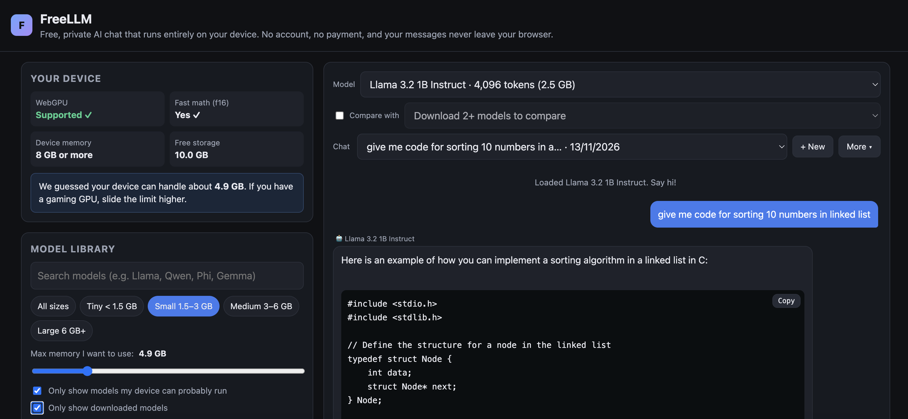
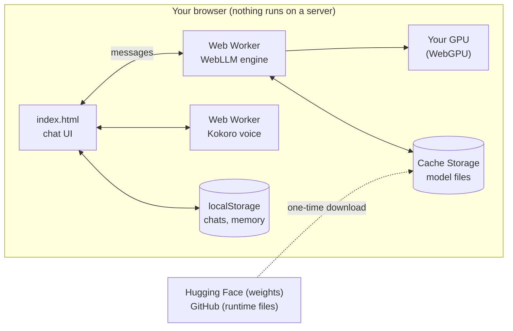
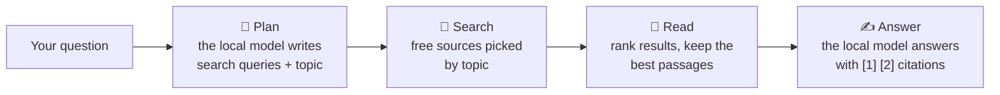

# FreeLLM

**A free, private AI chatbot that runs entirely in your browser. No servers, no accounts and no API keys.**

🔗 **Live demo:** https://ankitrathi85.github.io/freellmbot/



FreeLLM downloads open-source language models (Llama, Qwen, Phi, Gemma, Mistral and more) into your browser once, then runs them on your own GPU with WebGPU. Your chats, memory and attached files stay on your device. The whole app is one static `index.html` file (plus a small offline helper and icons), hosted for free on GitHub Pages.

---

## Features

- **Local AI chat.** Pick from dozens of open models, download each one once, and then chat even when you're offline. Replies stream in, and code blocks have Copy buttons.
- **Smart model library.** It checks your device (WebGPU, f16 support, memory, storage), filters by size, and groups models that share the same files into one card with a "Chat memory" (context size) choice.
- **Compare mode.** Two models answer the same question side by side.
- **Chat with your documents.** Attach TXT, Markdown, CSV, JSON, code, PDF or Word files. Long documents are cut into the passages that best match your question, so they fit small models.
- **🌐 Optional web lookup.** The AI plans a search, queries free sources that need no sign-up, reads the best pages and answers with numbered citations. A "Show what was found" panel shows exactly what the model was given.
- **Memory.** Save a chat as short notes that the AI remembers in future chats. You can see and edit them at any time.
- **🔊 Read aloud.** Natural-sounding voices (Kokoro) are generated in the browser, and you can download them as WAV.
- **Saved chats.** Chats are kept in your browser. You can export them as JSON or Markdown and import them on another device.
- **Stays responsive.** The language model and the voice model each run in their own Web Worker, so the page doesn't freeze while they work.
- **Install it like an app, use it offline.** FreeLLM is a PWA (Progressive Web App): add it to your home screen or dock and it opens in its own window. After one visit, the app opens without internet, and models you've downloaded keep working.

## How it works



**Web lookup (only when 🌐 is on):**



1. **Plan:** the loaded model turns your message into JSON: should it search, what topic is it, which 1–2 queries to use and what place (for weather). Abbreviations are expanded and follow-ups like "what about yesterday?" are resolved.
2. **Search:** sources are picked by topic (sports, news, weather, code, books, research, general), and they run in parallel with timeouts. A failing source is marked and skipped, so it never breaks the chat.
3. **Read:** results are de-duplicated and ranked, and the best passages are fitted to the model's context window.
4. **Answer:** the results go into your message with today's date and an instruction to trust them over the model's memory and to cite them.

## Privacy

| Stays on your device | Leaves your device |
|---|---|
| Your chats and chat history | **Always (downloads only):** model weights and the voice model from Hugging Face, each model's small runtime file from GitHub (`raw.githubusercontent.com/mlc-ai`), and the app's libraries from jsDelivr. These are plain file downloads; nothing about you or your chats is sent. |
| Attached files and their text | **Only when 🌐 is on:** the search query, sent to the web sources listed below |
| Memory notes | **Only when 🌐 is on:** the address of any link you paste in a message (read through Jina Reader) |
| Voice audio | |
| The offline copy of the app (kept by `sw.js`) | |
| All AI processing | |

- There is no backend, no analytics, no cookies and no account.
- The search query is a short rewrite of your question. To resolve follow-ups, it may include words from your last few messages (e.g. a team or product name). Your full chat and your files are never sent.
- Pages from search results are fetched through Jina Reader, so Jina sees which URLs are read.
- DuckDuckGo Instant Answers is loaded through JSONP (a script tag), which is the only way DuckDuckGo allows browser access.
- Turn 🌐 off, or switch off individual sources in "Web sources", to stay fully offline.
- The offline helper (`sw.js`) only saves the app's own files and its JavaScript libraries. It doesn't read, send or store your chats, and it never touches model downloads or web searches.

## Browser requirements

FreeLLM needs **WebGPU**:

- **Chrome or Edge** (recent versions) on Windows, macOS, Linux or ChromeOS
- **Chrome on a recent Android** phone
- **Safari 26 or newer** (macOS, iOS, iPadOS)

Without WebGPU you can still browse the model list, but you can't run models. Smaller "Tiny" models (under 1.5 GB) are best for phones and older laptops. For good web answers, use a 3B+ model.

## Run locally

WebGPU only works on `localhost` or HTTPS, so serve the folder instead of opening the file directly:

```bash
npx serve .
# then open http://localhost:3000
```

The VS Code **Live Server** extension works too.

The offline helper always fetches the newest files when you're online, so your edits show up on a normal reload. To remove it while testing, use DevTools → **Application** → **Service workers** → **Unregister**.

> Models are cached **per origin** (site address). A model downloaded on `localhost:3000` must be downloaded again on `localhost:5500` or on the live site.

## Deploy to GitHub Pages

1. Create a public repo named `freellmbot` on GitHub and push all the files (`index.html`, `sw.js`, `manifest.webmanifest`, `icons/`, `docs/`, `README.md`, `LICENSE`) to the `main` branch.
2. In the repo, go to **Settings → Pages**.
3. Under **Build and deployment**, choose **Source: Deploy from a branch**, **Branch: `main`**, folder **`/ (root)`**, and save.
4. After a minute or two, the site is live at `https://ankitrathi85.github.io/freellmbot/`.

There is no build step. Every push to `main` redeploys the site. Keep the URL stable, because changing it means users have to download their models again.

## Limitations

- **Needs WebGPU:** a recent Chrome or Edge, Chrome on a newer Android phone, or Safari 26+.
- **Small models can be wrong.** Web answers are only as good as what the free sources return. Check anything important.
- **Scraping-based sources** (Brave Search and Bing News through Jina Reader) can break if those sites change. They're used for personal, non-commercial purposes only.
- **Rate limits:** Jina Reader's free tier allows about 20 requests a minute per visitor, and Stack Exchange allows 300 searches a day without a key.
- **Read-aloud is English only.** There's no image or video generation, because there are no practical in-browser models for that yet.
- **Chats live in one browser.** Export them regularly as a backup.
- **Always the latest WebLLM.** The app loads the newest WebLLM release on purpose so that new models appear automatically. A breaking upstream change could affect the app until it's updated.

## Credits

FreeLLM is a non-commercial hobby project. It is built on the work of these projects and services. Thank you!

### Runtime and libraries

| Project | Used for | Licence |
|---|---|---|
| [WebLLM](https://github.com/mlc-ai/web-llm) by [MLC AI](https://mlc.ai/) | In-browser LLM inference on WebGPU, plus the model catalogue | Apache-2.0 |
| [Kokoro-82M](https://huggingface.co/hexgrad/Kokoro-82M) by hexgrad ([ONNX build](https://huggingface.co/onnx-community/Kokoro-82M-v1.0-ONNX)) | Text-to-speech voices | Apache-2.0 |
| [kokoro-js](https://www.npmjs.com/package/kokoro-js) | Running Kokoro in the browser | Apache-2.0 |
| [pdf.js](https://github.com/mozilla/pdf.js) by Mozilla | Reading PDF files | Apache-2.0 |
| [mammoth.js](https://github.com/mwilliamson/mammoth.js) | Reading Word (.docx) files | BSD-2-Clause |
| [jsDelivr](https://www.jsdelivr.com/) / [esm.run](https://esm.run/) | Serving the libraries from a CDN | — |

### Models

Model files are converted by MLC AI and downloaded from [Hugging Face (mlc-ai)](https://huggingface.co/mlc-ai). FreeLLM doesn't host, change or train any model. **Each model has its own licence**, set by its original makers. Tap "Source & license ↗" on a model card to read it.

The table below was checked on **13 Nov 2026** against the licence each original model declares on Hugging Face, for every chat model in WebLLM's catalogue at that time.

| Makers | Families in WebLLM | Licence (from the original model page) |
|---|---|---|
| [Meta](https://huggingface.co/meta-llama) | Llama 2, Llama 3, 3.1, 3.2 | [Llama 2](https://huggingface.co/meta-llama/Llama-2-7b-chat-hf), [Llama 3](https://huggingface.co/meta-llama/Meta-Llama-3-8B-Instruct), [Llama 3.1](https://huggingface.co/meta-llama/Llama-3.1-8B-Instruct) and [Llama 3.2](https://huggingface.co/meta-llama/Llama-3.2-1B-Instruct) Community Licenses (each version has its own) |
| [Alibaba Qwen](https://huggingface.co/Qwen) | Qwen2, Qwen2-Math, Qwen2.5 (incl. Coder, Math), Qwen3, Qwen3.5 | Apache-2.0, **except Qwen2.5-3B-Instruct and Qwen2.5-Coder-3B-Instruct**: [Qwen Research License](https://huggingface.co/Qwen/Qwen2.5-3B-Instruct/blob/main/LICENSE) (non-commercial) |
| [Microsoft](https://huggingface.co/microsoft) | Phi-1.5, Phi-2, Phi-3, Phi-3.5, Phi-4-mini | MIT |
| [Google](https://huggingface.co/google) | Gemma, Gemma 2, Gemma 3, Gemma 4 | [Gemma Terms of Use](https://ai.google.dev/gemma/terms) for Gemma 1–3; **Apache-2.0 for Gemma 4** |
| [Mistral AI](https://huggingface.co/mistralai) | Mistral 7B, Ministral 3 | Apache-2.0 |
| [Hugging Face](https://huggingface.co/HuggingFaceTB) | SmolLM2 | Apache-2.0 |
| [DeepSeek](https://huggingface.co/deepseek-ai) | DeepSeek-R1-Distill (Llama 8B, Qwen 7B) | MIT; the Llama-based one is also under the Llama 3.1 licence, as its model card notes |
| [Nous Research](https://huggingface.co/NousResearch) | Hermes 2 Pro, Hermes 2 Theta, Hermes 3 | Llama 3 licence for the Llama-based ones; Apache-2.0 for Hermes 2 Pro Mistral. Hermes 2 Theta declares Apache-2.0 but is built on Llama 3, so Llama 3's terms apply too |
| [Teknium](https://huggingface.co/teknium) | OpenHermes 2.5 Mistral | Apache-2.0 |
| [Maxime Labonne](https://huggingface.co/mlabonne) | NeuralHermes 2.5 Mistral | Apache-2.0 |
| [Allen Institute for AI (Ai2)](https://huggingface.co/allenai) | OLMo 2 | Apache-2.0 |
| [TinyLlama](https://huggingface.co/TinyLlama) | TinyLlama | Apache-2.0 |
| [Together AI](https://huggingface.co/togethercomputer) | RedPajama-INCITE | Apache-2.0 |
| [Stability AI](https://huggingface.co/stabilityai) | StableLM 2 Zephyr 1.6B | [Stability AI Non-Commercial Research Community License](https://huggingface.co/stabilityai/stablelm-2-zephyr-1_6b) |
| [WizardLM](https://huggingface.co/WizardLMTeam) | WizardMath 7B v1.1 | No licence declared on its model page; it's built on Mistral 7B (Apache-2.0) |

FreeLLM is free and non-commercial, which fits every licence above. If you reuse FreeLLM commercially, avoid the non-commercial models (the two Qwen2.5 3B models and StableLM 2) and follow Meta's and Google's terms.

The model list comes live from WebLLM, so models may be added or removed over time.

### Web sources (used for personal, non-commercial purposes)

| Source | Used for | Terms |
|---|---|---|
| [Jina Reader](https://jina.ai/reader/) | Fetching pages and search results as text | Free tier, rate-limited |
| [Brave Search](https://search.brave.com/) | General web search results (read through Jina) | Personal, non-commercial use |
| [Bing News](https://www.bing.com/news) | News headlines through RSS (read through Jina) | Personal, non-commercial use |
| [Wikipedia](https://www.wikipedia.org/) / [MediaWiki API](https://www.mediawiki.org/wiki/API:Main_page) | Background facts, Current Events portal, sports match tables | Content under [CC BY-SA 4.0](https://creativecommons.org/licenses/by-sa/4.0/) |
| [DuckDuckGo Instant Answer API](https://duckduckgo.com/duckduckgo-help-pages/open-source/instant-answer-interface/) | Quick answers and definitions | DuckDuckGo terms |
| [Open-Meteo](https://open-meteo.com/) | Weather and geocoding | Data under [CC BY 4.0](https://creativecommons.org/licenses/by/4.0/), free for non-commercial use |
| [Stack Exchange API](https://api.stackexchange.com/) | Stack Overflow questions and answers | Content under [CC BY-SA](https://stackoverflow.com/help/licensing) |
| [Hacker News Search (Algolia)](https://hn.algolia.com/api) | Tech discussions | HN / Algolia terms |
| [Open Library](https://openlibrary.org/developers/api) | Books and authors | Open Library terms |
| [Crossref REST API](https://www.crossref.org/documentation/retrieve-metadata/rest-api/) | Research paper metadata | Crossref terms (metadata is mostly CC0) |

All trademarks belong to their owners. FreeLLM isn't affiliated with or endorsed by any of these projects or companies.

## Licence

The FreeLLM app code is released under the [MIT License](LICENSE) © 2026 Ankit Rathi.
Models, libraries and web content keep their own licences (see [Credits](#credits)).

---

Made by **Ankit Rathi**. [GitHub](https://github.com/ankitrathi85) · [LinkedIn](https://www.linkedin.com/in/ankitrathi85/)
